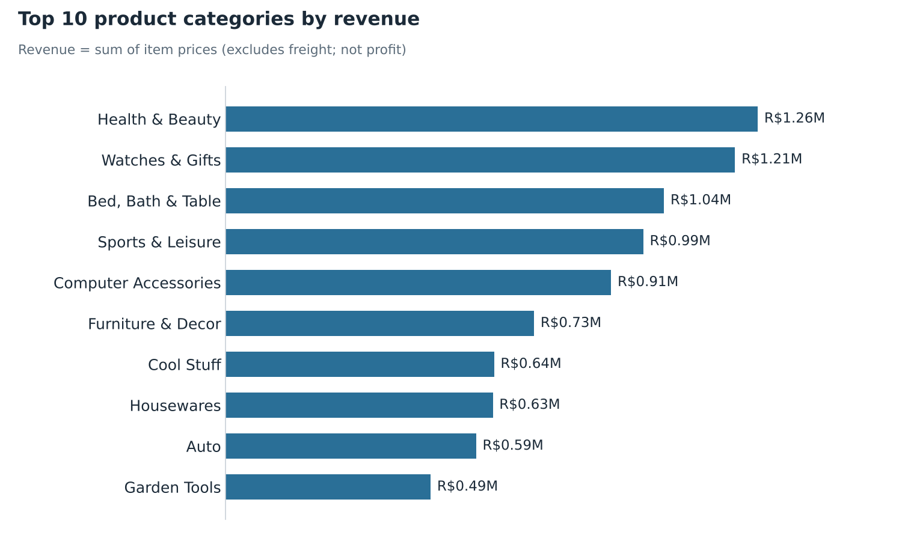

# Brazilian E-Commerce: Exploratory Data Analysis & Business Insights

Exploratory data analysis of the [Olist Brazilian E-Commerce dataset](https://www.kaggle.com/datasets/olistbr/brazilian-ecommerce) using Python. The project looks at order performance, product sales, customer geography, shipping costs and delivery operations, and turns the results into business insights.



## Business Questions

1. How are orders distributed by status, and how many reach the customer?
2. What does a typical order look like (value and shipping cost), and how skewed is the distribution?
3. Which product categories and individual products drive sales volume and revenue?
4. Where are customers located, and does order value differ across states?
5. Is freight cost related to product price?
6. How do orders change over time, and how long does delivery take compared with the estimate? *(code included in the notebook; see the note below)*

## Dataset

[Olist Brazilian E-Commerce](https://www.kaggle.com/datasets/olistbr/brazilian-ecommerce) on Kaggle. Five tables are used:

| Table | Rows |
|---|---|
| orders | 99,441 |
| order_items | 112,650 |
| products | 32,951 |
| customers | 99,441 |
| payments | 103,886 |

The raw data is **not** stored in this repository. The notebook downloads it with `kagglehub` (a Kaggle account may be required).

## Tools

Python · Pandas · NumPy · Matplotlib · Seaborn · Jupyter Notebook

## Project Structure

```
Brazilian-E-Commerce-EDA/
├── notebooks/
│   └── Olist_EDA.ipynb        # full analysis
├── visuals/
│   └── charts/                # charts used in the LinkedIn carousel
├── linkedin/
│   ├── carousel.pdf           # LinkedIn document post                
├── README.md
├── requirements.txt
└── .gitignore
```

## How to Run

```bash
git clone https://github.com/<your-username>/Brazilian-E-Commerce-EDA.git
cd Brazilian-E-Commerce-EDA
pip install -r requirements.txt
jupyter notebook notebooks/Olist_EDA.ipynb
```

Then choose *Restart & Run All*.

## Notebook Outline

1. Project Overview
2. Setup & Data Loading
3. Data Understanding
4. Data Quality & Preparation
5. Order Analysis
6. Product & Category Analysis
7. Customer & Geographic Analysis
8. Delivery & Shipping Analysis
9. Business Insights & Recommendations

## Key Findings

- **Order status:** 96,478 of 99,441 orders (97.02%) were delivered; 625 were canceled and 609 were unavailable.
- **Order value:** average R$137.75 vs. median R$86.90 (98,666 orders with items). The mean is pulled up by a few large orders; the maximum is R$13,440.
- **Shipping:** average freight is R$22.82 per order, taking the average order total to R$160.58.
- **Price vs. freight:** correlation of 0.41, a moderate positive relationship.
- **Categories:** health & beauty has the highest product revenue (about R$1.26M), followed by watches & gifts (R$1.21M) and bed, bath & table (R$1.04M). Bed, bath & table leads in units sold (11,115).
- **Volume is not revenue:** the most frequently sold product (527 sales) is not the top earner, and a `pcs` product made R$48.9K from only 35 sales.
- **Geography:** São Paulo accounts for about 42% of orders (41,746); SP, RJ and MG together account for about 67%. Paraíba has the highest average order value (R$216.67, 532 orders).

## Definitions and Limitations

- "Revenue" and "order value" are the **sum of item prices**. Freight is shown separately, and costs, discounts, refunds and profit are not included.
- Average order value is computed over the 98,666 orders that have items, not all 99,441 orders.
- Products with a missing category (610 rows in `products`) are excluded from category-level figures.
- Only 5 of the 9 Olist tables are used.
- The analysis is descriptive. Correlation does not imply causation, and no statistical tests or predictive models are used.
- **Monthly trends and delivery performance** (notebook sections 5.5 and 8.2) were added as code during the final polish. Run the notebook to see their results; no figures from them are quoted here.

## Author

**Habiba Anwer**: Junior Data Analyst (aspiring) · [LinkedIn](www.linkedin.com/in/habiba-anwer-798092156) · [GitHub](https://github.com/habibaanwer2568)

Data source: Olist, via Kaggle (see the dataset page for its license).
